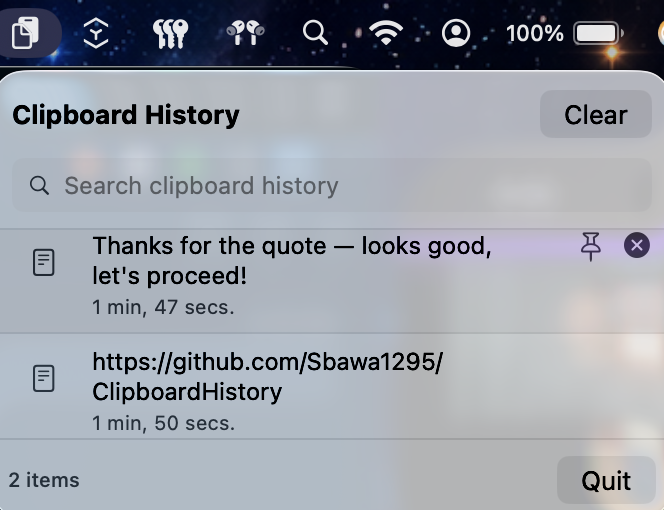

# Clipboard History

A lightweight, native macOS menu bar app that keeps a searchable history of everything you copy.


## Features

- 📋 **Automatic history** — remembers your last 100 text and image clips
- 🔍 **Search** — instantly filter history by content
- 📌 **Pin favorites** — pinned items never age out, no matter how much you copy
- 🖱️ **One click to paste** — click any item to copy it back to your clipboard
- 🪶 **Lightweight** — native Swift/SwiftUI, no Electron, tiny memory footprint
- 🔒 **100% local** — nothing ever leaves your Mac; history is stored only in
  `~/Library/Application Support/ClipboardHistory/`
- 🚀 **Menu bar only** — no Dock icon, stays out of your way

## Screenshot



## Installation

### Option 1: Download a release

Grab the latest `.zip` from the [Releases](../../releases) page, unzip, and
drag `ClipboardHistory.app` into `/Applications`.

> The app isn't signed with an Apple Developer certificate yet, so on first
> launch macOS will warn it's from an unidentified developer. Right-click the
> app → **Open** → **Open** to bypass this once.

### Option 2: Build from source

Requires Xcode (or the Xcode Command Line Tools) with Swift 5.9+.

```bash
git clone https://github.com/Sbawa1295/ClipboardHistory.git
cd ClipboardHistory
swift build -c release
```

Then package it as an app bundle:

```bash
APP=ClipboardHistory.app
mkdir -p "$APP/Contents/MacOS"
cp .build/release/ClipboardHistory "$APP/Contents/MacOS/"
cp Info.plist "$APP/Contents/Info.plist"
open "$APP"
```

## Usage

- Click the clipboard icon in your menu bar to see your history
- Click any item to copy it back to the clipboard
- Hover an item to pin it (keeps it permanently) or delete it
- Use the search bar to filter by content
- "Clear" removes all unpinned history

## Why another clipboard manager?

There are great free options like [Maccy](https://maccy.app). This one is a
small, from-scratch native build — contributions and forks welcome if you
want to take it in your own direction.

## Roadmap

- [ ] Global keyboard shortcut to open the popover from anywhere
- [ ] Code signing / notarization for a smoother first-launch experience
- [ ] Optional iCloud sync across Macs

## License

MIT — see [LICENSE](LICENSE).
